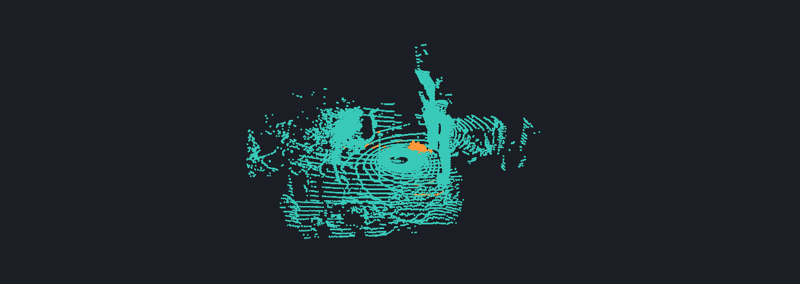

# 同帧对照，而不是两张“更干净”的云

下列三层全部是 UCHILE 公开 Exterior 帧 exterior2__Area_5__amtc_063 的原生 ROS1/RViz 图。两网来自同种子197配对实验，固定0.5为诊断操作点。当前帧41,123行；FP/FN 相对发布者逐点标签，不把未标区计为TN。N0 FP=18、FN=267；N1 FP=424、FN=19。错判点数的交换不能由场景更稀疏或颜色更干净解释。

| 来源参考 | N0 | N1 |
|---|---|---|
|  |  |  |

本地归档保留 Exterior 原始强度图与逐点错误图。公开的 Interior 同视角原始/标签实测见 [ROS1 矿山训练帧](../review_tools/README.md)。[相机参数、源帧、截图摘要和无历史叠加收据](../temporal_open3d_v1/review/paired_network_197/check/case_2/capture.json)。上列 FP/FN 来自同帧固定阈值的逐点复核。图像没有提供新的人为材料认证。
