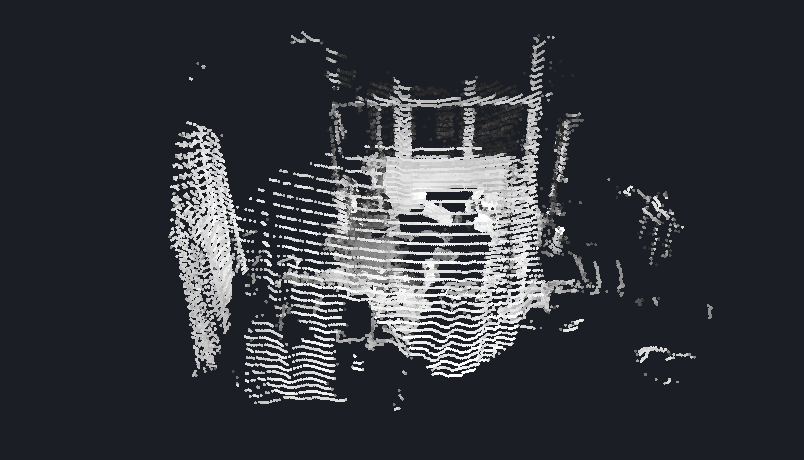
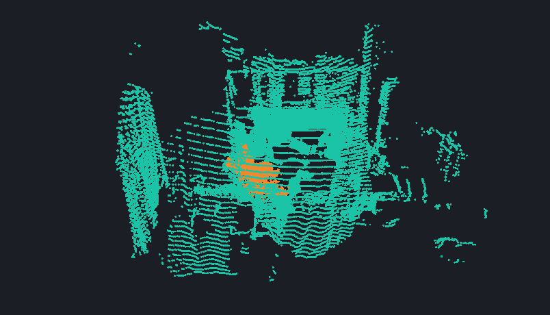

# 统一读取器到冻结模型 / ROS1：一帧真实矿山训练样本

本例只接受 UCHILE 的 `interior1/Area_1/amtc_068`。统一清单把它列为 train，冻结的公开源域 N0、seed 197 的实际训练清单也包含它。没有访问待留出样本、训练模型、调整阈值或计算测试性能。原始设备 ROS 消息和物理时钟在这个发布子集不可用；下文的 raw 是发布的**处理后** coord/intensity 原输入。

| 检查 | 实测结果 |
|---|---|
| 统一源身份 | `uchile_e88fd9458921fc6aef6f`；NPY 行号 uint32，不由最近邻生成 |
| 来源标签 | 37,814 行均为有效监督；发布者 dust=0 对应任务码 2，共 3,200；non-dust=1 对应任务码 1，共 34,614 |
| 冻结 RandLA-Net | 36,633 个体素；回投并归一化后 37,814/37,814 原行获分。先过滤无效点才建邻域；体素投影是模型插值，与源行身份不同 |
| 可移植性 | 训练时封存入口与可移植入口各在 GPU 做一次完整前向；源适配七个数组两端一致，两次六项产物逐值相等（原索引、未归一化分数、归一化分数、valid、回投表及存储行号）。无优化器更新，权重状态前后相同 |
| ROS1 Noetic / RViz | 独立订阅者收到 raw、valid、reference、ignored、index 五个 PointCloud2；实际逐字节载荷、整数 source_point_index、字段和源帧标识核对一致。五张同相机 OGRE 原生渲染。本帧 ignored 为 0，空图为空层，未验证非空忽略区域的可见性 |

这两个渲染来自同一帧、相同相机；灰度为发布强度，青绿为来源 non-dust，橙色为来源 dust。颜色不是新的材料鉴定或模型预测。图为本项目从公开来源新渲染。数据和论文：Bruno Cavieres、Nicolás Cruz、Javier Ruiz-del-Solar，[UCHILE-Dust 数据](https://github.com/nicolasCruzW21/UCHILE-Dust)、[Sensors 2025, 25(20), 6441](https://doi.org/10.3390/s25206441)。





## 本地复现

在仓库根目录执行。先按数据入口说明生成清单，设置 `DATA_ROOT`（包含 `dataset_polvo/`）及可写 `DERIVED_ROOT`。脚本每次要求新建目标文件，避免覆盖先前验证。

```bash
export PYTHONPATH="$PWD${PYTHONPATH:+:$PYTHONPATH}"
python3 -B review_tools/mining_check.py export \
    --output "$DERIVED_ROOT/validation/mining_train_view"
```

在具备 ROS1 Noetic、RViz Python bindings、PyQt5、NumPy、Pillow、OGRE 开发头文件、g++ 和可用图形显示的本机或已有容器内执行。仓库和 `DERIVED_ROOT` 须在容器中可读，输出目录可写。按本机实际图形会话设置 `DISPLAY`。

```bash
bash review_tools/ros1_mining.sh "$DERIVED_ROOT/validation/my_new_capture"
# 交互旋转、缩放、切换五层，关闭 RViz 窗口结束本次会话：
MINING_CAPTURE=0 bash review_tools/ros1_mining.sh "$DERIVED_ROOT/validation/my_new_interactive"
```

默认只使用 localhost 专用端口 11483；端口正在使用会直接退出。可用 `MINING_REVIEW_PORT` 选择 11450–11499 内的其他空闲端口。只处理本进程创建的 Master；不连接现有车辆 ROS Master。静态帧没有可信物理时间戳，消息使用 ROS 零时间，并在来源收据中明确 unavailable。index 层颜色仅便于查看；精确原行号为 PointCloud2 的整数 `source_point_index` 字段，不能由颜色反推。valid 层保留全部有效行，ignored 层仅显示几何有效且不参与监督的行；无效 XYZ 不画假点。

要验证冻结网络，需自行获得受授权的 N0 public seed197 的训练运行目录（`config.json`、`preprocessing.json`、`best.pt`）、固定上游 Open3D-ML 检出和相容的 PyTorch/CUDA GPU 环境。脚本核验训练清单成员、固定 checkpoint SHA、模型源码版本和统一读取器输入摘要；文件不齐会中止，不能拿任意下载权重替代。例：

```bash
export MODEL_CODE_ROOT="$PWD/temporal_open3d_v1"
: "${CHECKPOINT_DIR:?path to authorized public-N0 seed197 run}"
: "${OPEN3D_ML_ROOT:?path to pinned upstream Open3D-ML checkout}"
python3 -B review_tools/mining_check.py infer \
    --receipt "$DERIVED_ROOT/validation/mining_train_view/input.json" \
    --output "$DERIVED_ROOT/validation/my_new_forward"
```

冻结 checkpoint SHA256：`acc9d569980701d45e43899ddbeaa355954b012a405af4ac49ecd7e447dba595`；上游模型 commit：`a3d0f7a51d4eef0b94b9000a7d74af05e2d54c4f`。源码、两张代表性截图及小型验证收据在仓库中；不分发源点数组、完整分数、训练权重、原生运行日志或机器连接配置。
